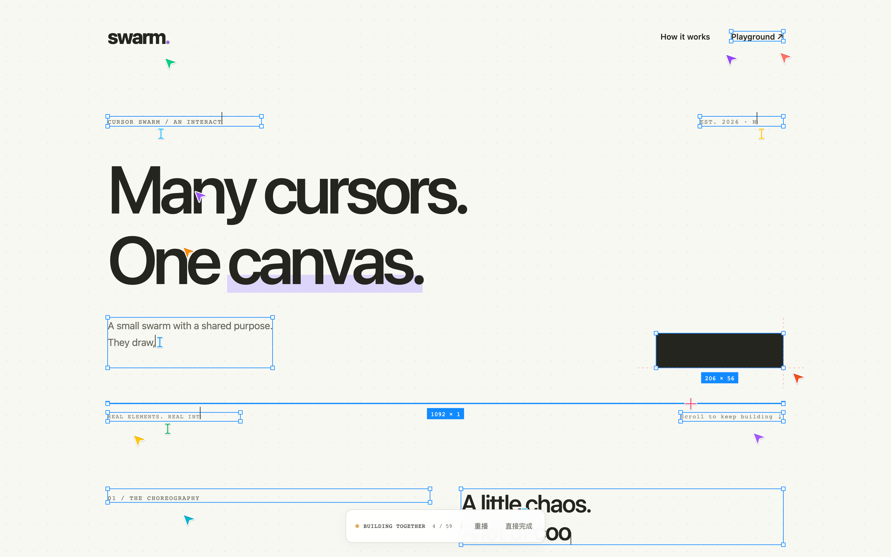
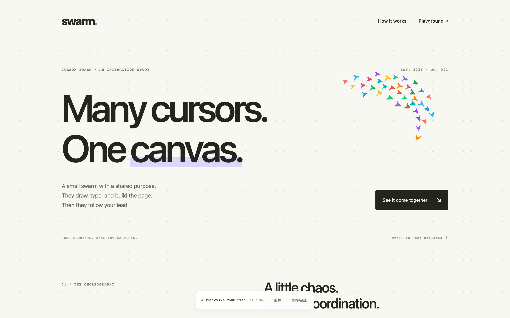

# Agent Skills · 浪里小白龙的 Skill 合集

把做过、调过、验证过的实用能力封装成 Skill，让 AI 在新项目中继续使用。

这里持续收录我的通用版 Skills。每个 Skill 独立存放，包含使用说明，以及完成任务所需的核心代码或参考资料。

## Skill 目录

| Skill | 能做什么 | 入口 |
| --- | --- | --- |
| **Agent 集群搭建页面** · `cursor-swarm` | 为网页加入几十个彩色光标协作打字、拉框、绘制、分散游走，以及完工后成群跟随鼠标的效果 | [查看 Skill](skills/cursor-swarm/SKILL.md) · [接入示例](skills/cursor-swarm/references/integration.md) |

## 第一个 Skill：Agent 集群搭建页面

一句话，为你的网页召唤一支 Agent 施工队。

它附带可复用的原生 JavaScript 核心实现，适合接入 HTML、React、Vue 等可编辑网页。光标经历开场环绕、分工施工、独立游走、新区域继续施工和完工跟随，页面保留原有内容与真实交互。





### 交给 AI 使用

下载仓库后，将完整的 `skills/cursor-swarm/` 文件夹交给支持 Skill 的编程 AI，或按所用工具的要求安装到 Skills 目录。需要同时保留 `SKILL.md`、`assets/` 和参考资料，核心实现就在文件夹中。

然后告诉 AI：

> 使用 cursor-swarm Skill，给我的网页加上 Agent 集群搭建页面的效果。复用附带的核心代码，保留现有内容、布局与交互，验证群体施工、分散游走和完工后的鼠标跟随。

Codex 安装后也可以通过 `$cursor-swarm` 调用。

### 本地体验

```sh
git clone https://github.com/a303557339/agent-skills.git
cd agent-skills
python3 -m http.server 4173 --bind 127.0.0.1 --directory skills/cursor-swarm
```

打开 <http://127.0.0.1:4173/demo/>，点击「开始绘制」并向下滚动，观察各区域施工与完工后的集群跟随。

运行时不依赖 npm 包。复跑测试的方法见[实际验证记录](skills/cursor-swarm/references/validation.md)。

### 适用范围

适合有源码或 DOM 修改权限的网页；接入需要由 AI 根据实际页面完成。PPT 中可以插入录制好的效果视频。参考站灵感、实现取舍与差异见[参考研究](skills/cursor-swarm/references/reference-study.md)。

## 合集结构

```text
agent-skills/
├── README.md
├── docs/images/            # 效果预览
└── skills/
    └── cursor-swarm/
        ├── SKILL.md       # Skill 入口
        ├── agents/        # AI 工具展示配置
        ├── assets/        # 核心实现
        ├── demo/          # 可运行演示
        ├── references/    # 接入与验证说明
        └── tests/         # 测试
```

后续新增 Skill 时，在 `skills/` 下增加独立文件夹，并更新上方目录即可。

作者：浪里小白龙
